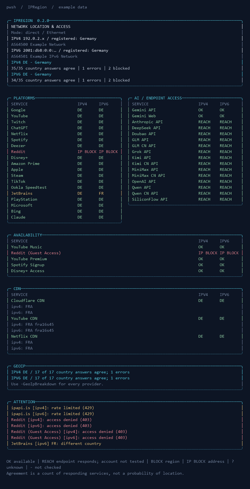

# IPRegion for Windows - your IP address location lookup

See which country GeoIP databases and platforms associate with your connection, and distinguish regional restrictions from network errors. Native PowerShell/.NET; no curl, jq, WSL, external runtime modules, accounts, or personal API keys.

Based on [vernette/ipregion](https://github.com/vernette/ipregion), with additional checks from [Davoyan/ipregion](https://github.com/Davoyan/ipregion).



## ✅ Requirements

Windows 10/11 or Windows Server with **PowerShell 7.4+**.

## Usage

### ⭐ 1. Run directly from GitHub

Open PowerShell 7 (`pwsh`) and paste this command. It fetches the script from the repository's `master` branch and runs it in memory, without saving a local file:

```powershell
& ([scriptblock]::Create((Invoke-RestMethod 'https://raw.githubusercontent.com/Grim1313/ipregion-for-windows/master/ipregion.ps1'))) -ThrottleLimit 1
```

To select checks or change the output, append parameters to the same command, for example:

```powershell
& ([scriptblock]::Create((Invoke-RestMethod 'https://raw.githubusercontent.com/Grim1313/ipregion-for-windows/master/ipregion.ps1'))) -ThrottleLimit 1 -Group GeoIP -IPv4 -Json
```

**Keep `-ThrottleLimit 1` for this method: parallel workers need a local script file. Use the second method for parallel execution. Direct execution uses the version currently published on GitHub.**

### ⭐ 2. Download and run locally

Open PowerShell 7 (`pwsh`) in the folder where you want to save the script, then run:

```powershell
Invoke-WebRequest 'https://raw.githubusercontent.com/Grim1313/ipregion-for-windows/master/ipregion.ps1' -OutFile ./ipregion.ps1
pwsh ./ipregion.ps1
```

The download command above saves the script with the correct filename.
To download it through a browser instead:

1. Open the [raw script](https://raw.githubusercontent.com/Grim1313/ipregion-for-windows/master/ipregion.ps1), then press **Ctrl+S**. Save this plain-text content, not the GitHub page that displays the code.
2. Save it as **`ipregion.ps1`**, not `ipregion.ps1.txt` or an `.html` file. If the save dialog offers a file-type selector, choose **All files**. Enable file name extensions in Windows Explorer to check the actual filename.
3. Open the saved file in a text editor: its first line should be `#requires -Version 7.4`. If it contains an HTML page instead, download the raw script again; renaming an HTML file to `.ps1` will not fix it.

Run the saved script from its folder in **PowerShell 7 (`pwsh`)**, using the command above.

The local copy supports **parallel checks** and the following options:

```powershell
# Complete report; intrusive checks are excluded
pwsh ./ipregion.ps1

# Several groups, individual services, or both
pwsh ./ipregion.ps1 -Group Platforms,AI
pwsh ./ipregion.ps1 -Service Steam,ChatGPT
pwsh ./ipregion.ps1 -Group AI -Service Netflix
pwsh ./ipregion.ps1 -ListServices

# GeoIP detail, compact terminal, or plain ASCII
pwsh ./ipregion.ps1 -Group GeoIP -GeoIpBreakdown
pwsh ./ipregion.ps1 -Width 80
pwsh ./ipregion.ps1 -Ascii -NoColor -NoProgress

# Independent direct IPv4 / IPv6 checks
pwsh ./ipregion.ps1 -IPv4
pwsh ./ipregion.ps1 -IPv6
pwsh ./ipregion.ps1 -Interface "Ethernet"

# Explicit proxy modes
pwsh ./ipregion.ps1 -Proxy 127.0.0.1:1080
pwsh ./ipregion.ps1 -SystemProxy

# The original JSON format remains the default
pwsh ./ipregion.ps1 -Json
pwsh ./ipregion.ps1 -Json -JsonVersion 2

# Bounded parallel execution; debug does not force sequential execution
pwsh ./ipregion.ps1 -ThrottleLimit 4 -Timeout 5
pwsh ./ipregion.ps1 -DebugLog -VerboseOutput

Get-Help ./ipregion.ps1 -Full
```

Short aliases: `-g`, `-s`, `-t`, `-4`, `-6`, `-p`, `-i`, `-j`, `-v`, `-d`. Selectors accept PowerShell arrays or comma-separated strings. Groups and individual services form a union without duplicate checks. With only `-Service`, unrelated groups are not run. Identity and network-registration lookups still populate the report header.

## Checks and report

- **Platforms:** country reported by Google, YouTube, Twitch, ChatGPT, Claude, Netflix, Spotify, Reddit, Disney+, Apple, Steam, TikTok, Ookla, JetBrains, PlayStation, Microsoft, plus **Deezer, Amazon Prime and Bing**.
- **Availability:** YouTube Premium, **YouTube Music**, Spotify signup, Disney+ and Reddit guest access. Google CAPTCHA and YouTube ad sampling are opt-in.
- **AI:** separate Gemini Web/API region lists, OpenAI, Anthropic, Grok, Qwen, Kimi, GLM, MiniMax, Doubao, SiliconFlow and DeepSeek endpoints, including distinct international/CN endpoints where available.
- **CDN:** Cloudflare, YouTube and Netflix country, IATA and node information where available.
- **GeoIP:** all 18 original providers retained, including **2ip.io**, iplocation.com and ipapi.is.

Legacy group names remain valid: `Primary` means `GeoIP`; `Custom` selects the original 25-service registry (24 without the opt-in CAPTCHA check). `All` includes new services. `Gemini Supported` / `gemini_supported` retains its original ID and means Gemini API; `gemini_api` is also a selector alias.

The report uses paired Platforms/AI cards at 96+ columns and stacked cards below that. Very narrow output places names above results instead of hiding the service name. GeoIP is summarized unless `-GeoIpBreakdown` or individual services are selected. `-NoAttention` hides the differences/failures card. Redirected output has no color or progress escapes; `NO_COLOR` is respected.

| Value | Meaning |
| --- | --- |
| Country code | Country reported by that service; CDN country describes the edge node |
| `OK` | The specific availability check found positive evidence |
| `REACH` | API endpoint returned a recognized authentication response; account/model access was not tested |
| `BLOCK` | Positive evidence of a region restriction |
| `IP BLOCK` | A service-specific IP denial or CAPTCHA |
| `DENIED` | Access denied, without enough evidence to identify the cause |
| `ERROR` | HTTP/network failure; the reason is in Attention / JSON v2 |
| `?` | Unexpected or incomplete response; no availability verdict |
| `-` | Not checked, or the observed exit cannot be assigned to the requested address |

Country agreement counts **responding country checks**, separately for IPv4, IPv6 and proxy observations. Ties have no winner. Errors, availability checks and CDN nodes do not vote. Agreement is not a probability of the actual location. Service access can also depend on account, age, subscription, cookies or anti-bot rules.

### Optional checks

```powershell
# Explicit selection enables only this intrusive check
pwsh ./ipregion.ps1 -Service google_search_captcha
pwsh ./ipregion.ps1 -Service youtube_no_ads -YouTubeLanguage ru

# Enable opt-in checks in all selected groups
pwsh ./ipregion.ps1 -Group Availability -IncludeIntrusiveChecks
```

YouTube ad sampling makes two requests with visitor cookies and examines one video with the selected interface language. `NO ADS` / `ADS` describes that observation, not a general guarantee. YouTube Music detects the web interface, not successful playback. Gemini checks official region lists, not account eligibility.

## Network behavior

**Direct is now explicit by default.** System/environment proxy settings are used only with `-SystemProxy`. If an earlier version silently used your Windows proxy, add this switch to retain that network path. `-Proxy` supports HTTP(S), SOCKS4/4a/5; an omitted scheme means SOCKS5. SOCKS5 sends the destination hostname to the proxy. URI credentials are supported (percent-encode special characters).

`-IPv4` and `-IPv6` are mutually exclusive. Without either switch, both exit families are discovered independently. An unavailable family is omitted. Some address-based GeoIP providers require IPv4 transport even when the queried address is IPv6.

A proxy chooses its own connection to each destination. For that reason, platform/availability/AI/CDN checks run **once** and appear under `proxy` in JSON v2, even if only one exit address was discovered. `-IPv4` / `-IPv6` select identity and explicit-address GeoIP queries; they do not force the proxy's exit family. System proxy bypass rules may also send individual requests directly. Cloudflare's observed address is checked before assigning its GeoIP result to a family.

`-Interface` takes the exact Windows adapter alias and binds direct sockets to an assigned address. It cannot be combined with `-Proxy` or `-SystemProxy`: binding a local socket does not select a proxy's exit interface.

ASN and RIR registration country are recorded separately for IPv4 and IPv6. MaxMind's existing endpoint is used when available, with a cookie/CSRF demo-token fallback; RIPE provides fallback ASN data. Country registration comes from RIR data rather than being substituted for GeoIP country.

Identical requests are deduplicated across workers within one run; there is no persistent cache across runs or network changes. Request keys include transport, proxy mode, interface, method, URL, headers, content type and body. Each request has one timeout budget across its attempts. Throttling/authorization failures and POSTs are not automatically retried. Responses are bounded to 16 MiB.

## JSON compatibility

`-Json` and `-Json -JsonVersion 1` retain the original top-level fields, `primary/custom/cdn` arrays, scalar `ipv4/ipv6` result cells and country-percentage structure. New platform/AI/availability rows go into `custom`. Existing service names and IDs are retained. Correctness fixes intentionally change misleading `Yes`/`No` results to `N/A` or the appropriate error status.

JSON v1 cannot represent a proxy-selected family honestly. In proxy modes its platform/availability/AI/CDN family cells are `null`, with a notice on stderr; explicit-address GeoIP results are retained. Use **v2** for proxy results.

`-Json -JsonVersion 2` adds:

- independent `ipv4` / `ipv6` network records with ASN source and MaxMind failure;
- explicit network mode and interface (proxy credentials are never included);
- `platforms`, `availability`, `ai`, `cdn`, `geoip` arrays with stable IDs;
- nullable `ipv4`, `ipv6`, `proxy` cells with `country`, `access`, `status`, `reason`, `httpStatus`, `elapsedMs`, `iata`, `node`;
- agreement counts/ties per protocol and an Attention list.

JSON contains full exit IPs for automation, as before. Human-readable output masks addresses. Debug/verbose logs mask IPs, URL credentials and query tokens; logs are local and are never uploaded automatically.

Schemas: [v1](schema/ipregion-v1.schema.json), [v2](schema/ipregion-v2.schema.json). Examples with documentation-only addresses: [v1](tests/fixtures/report-v1.json), [v2](tests/fixtures/report-v2.json). The Windows v2 schema is its own contract; it is not claimed to be byte-for-byte compatible with the Bash project's schema.

## Development and validation

Runtime remains dependency-free. Development modules are pinned:

```powershell
Install-PSResource Pester -Version 5.7.1 -Scope CurrentUser -TrustRepository
Install-PSResource PSScriptAnalyzer -Version 1.25.0 -Scope CurrentUser -TrustRepository
Import-Module Pester -RequiredVersion 5.7.1
Invoke-Pester ./tests
Invoke-ScriptAnalyzer . -Recurse -Settings ./PSScriptAnalyzerSettings.psd1

# Reproduce visual previews with synthetic data; no network requests
pwsh ./tools/Preview-Report.ps1 -Columns 100
pwsh ./tools/Preview-Report.ps1 -Columns 32

# Live checks are separate from deterministic tests
pwsh ./ipregion.ps1 -Group GeoIP -IPv4 -Json
pwsh ./ipregion.ps1 -Group AI -IPv4 -Json -JsonVersion 2
```

Tests cover error/consent/partial responses, region-list parsing, both JSON contracts, per-family metadata, real loopback SOCKS5 exchange (including authentication and proxy DNS), shared concurrent cache, retry deadlines, redaction and layouts at 32–120 columns. CI runs the suite on PowerShell 7.4.22 and 7.6.9. Pester 5.7.1 is intentionally retained for reproducibility; adopting the newer major version is a separate development-tool migration.

Service endpoints are third-party APIs/pages and may change or reject a particular network. A failed live check is reported per service and does not erase successful results.

## Upstream and licensing

Original: [vernette/ipregion](https://github.com/vernette/ipregion). Additional checks studied: [Davoyan/ipregion](https://github.com/Davoyan/ipregion). MIT; existing attribution is retained in [LICENSE](LICENSE).
